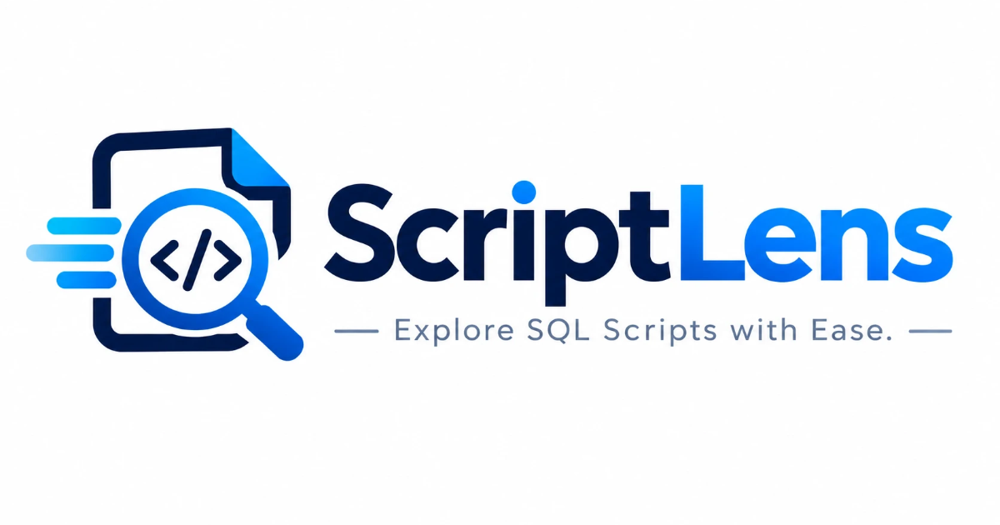

# ScriptLens



ScriptLens lets you open, search, sort and export SQLite databases in your browser. It has no backend: the file is read locally with [sql.js](https://github.com/sql-js/sql.js) (SQLite compiled to WebAssembly), so nothing is uploaded and the database is never modified.

**Live:** https://thisaraariyawansha.github.io/scriptlens/

## Features

- **Private and read-only.** The database is loaded in memory with `PRAGMA query_only = ON`. Nothing leaves your computer.
- **Open by drag and drop**, or with the file picker. Supports `.sqlite`, `.sqlite3`, `.db`, `.db3` and `.s3db`.
- **Table browser.** Lists tables and views with their row counts. You can filter by name and hide empty tables.
- **Search all columns.** Searches every column of the current table at once and highlights the matches.
- **Sort.** Click a column header to sort ascending, then descending, then turn sorting off.
- **Pagination.** Shows 100 rows per page.
- **Structure view.** Shows each column's type, primary key, NOT NULL constraint and default value, plus the table's `CREATE` statement.
- **Row inspector.** Click a row, or press Enter on it, to see every value in full. You can copy the row as JSON.
- **CSV export.** Exports the whole table, or only the rows that match your search, with your current sort order.

## Keyboard shortcuts

| Key | Action |
| --- | --- |
| `/` | Focus search |
| `Esc` | Clear search / close the row inspector |
| `↑` `↓` | Move between rows |
| `Enter` / `Space` | Open the selected row |

## Running locally

There is no build step. Serve the folder with any static file server, for example:

```sh
npx serve .
# or
python -m http.server
```

Then open the URL it prints. You need an internet connection the first time, because sql.js is loaded from cdnjs.

## Project structure

```
index.html      Page markup and meta tags
css/style.css   Styles
js/app.js       App logic (file loading, table list, grid, search, export)
images/         Icons and the social preview image
favicon.ico
```

## Deployment

The site is static and is hosted on GitHub Pages from the `main` branch.
